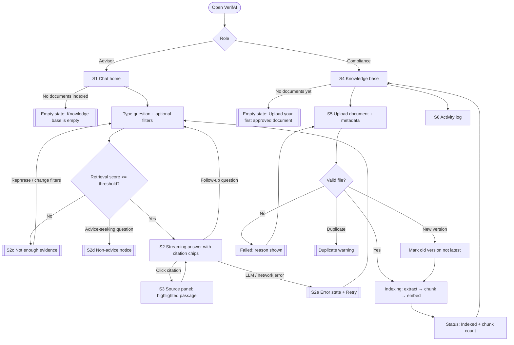
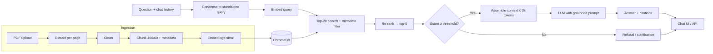

# PRD — VerifAI: Financial Advisory Compliance RAG Assistant

| Field | Value |
|---|---|
| Sprint | Sprint 2 — AI Application Development with RAG |
| Squad / Team | 65 / 03 |
| Version | v2.0 (revised after mentor review) |
| Status | Resubmitted for approval |
| Mock UX | [Figma — team03-sprint2-verifai](https://www.figma.com/design/7pcEIJXsNINuurET3JCF9y/team03-sprint2-verifai-?node-id=0-1) · annotation spec: [docs/MOCK_UX_ANNOTATIONS.md](docs/MOCK_UX_ANNOTATIONS.md) |

### Revision log (response to review feedback)

| # | Feedback | Where it is addressed |
|---|---|---|
| 1 | Quantify the business problem | §1.2 Problem sizing |
| 1 | Strictly formatted KPIs (metric + measurement + target + timeline) | §4 KPIs |
| 2 | Exact dataset parameters | §6 Dataset specification |
| 2 | Rewrite user journey as formatted user stories | §7 User stories |
| 3 | Add impact to risks | §13 Risk register |
| 3 | Annotations, empty states, flow diagram for Figma | §8 Flow diagram, §9 Empty states, [docs/MOCK_UX_ANNOTATIONS.md](docs/MOCK_UX_ANNOTATIONS.md) |

---

## 1. Problem

### 1.1 Problem statement

A financial advisory firm maintains market research, fund factsheets, and regulatory disclosures, but advisors risk giving non-compliant guidance because they cannot quickly verify answers against the latest **approved** documents. Today, verification means manually searching a shared drive of long PDFs, so advisors either spend a long time looking or answer from memory — and memory is often based on an older factsheet.

### 1.2 Problem sizing

We size the problem for a representative mid-sized advisory firm. Figures marked *Assumption* are working estimates; they will be validated through 5 advisor interviews and a timed lookup exercise in Week 1, and the PRD will be updated with measured values.

| Parameter | Baseline value | Basis |
|---|---|---|
| Advisors in firm | 50 | Assumption — mid-sized firm |
| Client questions per advisor per day that need a document check | 8 | Assumption |
| Time to find and verify one answer manually | 12 min (median) | Assumption — to be measured in Week 1 timed exercise |
| Approved documents in the shared drive | ~500 PDFs, refreshed monthly (factsheets) | Assumption |
| Share of manual answers that cite an outdated or unapproved document | 10% | Assumption — to be measured in Week 1 audit of 50 sample answers |

**Derived impact (baseline):**

- **Time lost:** 50 advisors × 8 checks × 12 min = **80 advisor-hours per day ≈ 1,760 hours per month** (22 working days).
- **Compliance exposure:** 50 × 8 × 22 × 10% ≈ **880 client answers per month** potentially based on outdated or unapproved material. Each one is a possible mis-selling complaint or regulatory finding.
- **Opportunity:** cutting verification time from 12 min to ≤ 1 min frees **~1,600 advisor-hours per month**, and grounding every answer in a cited, approved source targets ≤ 1% outdated-source answers.

### 1.3 Product vision

VerifAI is a Retrieval-Augmented Generation (RAG) assistant that lets advisors ask questions about approved documents and get grounded answers with page-level citations in under 10 seconds. When the approved documents do not contain enough evidence, VerifAI says so instead of inventing an answer.

---

## 2. Target users

| Persona | Role | Core need | Frequency |
|---|---|---|---|
| **Advisor** (primary) | Client-facing financial advisor | Verify a fact (e.g. a fund's expense ratio, exit load, risk category) before telling a client, and show where it came from | 5–15 questions per day |
| **Compliance officer** (secondary) | Maintains the approved document set | Upload, replace and retire documents; check that the assistant only answers from approved sources; review refusals | Weekly / on each monthly factsheet release |

---

## 3. Goals and non-goals

### 3.1 Goals

1. Ingest approved documents (upload → extract → clean → chunk with metadata).
2. Embed chunks and store them in a vector database.
3. Retrieve relevant chunks with top-K semantic search, metadata filters and optional re-ranking.
4. Generate grounded answers with page-level source citations.
5. Refuse or ask for clarification when evidence is insufficient.
6. Support conversational follow-ups.
7. Provide a backend RAG API and a chat UI with streaming.
8. Evaluate retrieval and answer quality against a labelled test set.
9. Deploy and document a reproducible application.

### 3.2 Non-goals

- Autonomous or personalised financial advice (e.g. "should my client buy fund X").
- Trade or investment execution.
- Replacing compliance professionals or guaranteeing legal/regulatory compliance.
- Training a foundation model from scratch.
- Answering from information outside the approved document set (no web search).
- OCR of scanned/image-only PDFs (Sprint 2 supports text-based PDFs only).

---

## 4. KPIs

Every KPI below is measured on the evaluation set defined in §6.4 unless stated otherwise. Timelines are sprint weeks (Week 1 = first week of Sprint 2 build).

| ID | KPI | Metric (definition) | Measurement method | Target | Timeline |
|---|---|---|---|---|---|
| K1 | Retrieval recall | Recall@5 = share of answerable questions where ≥ 1 labelled relevant chunk is in the top 5 retrieved | Automated script over the 75 answerable eval questions | **≥ 0.85** | End of Week 3 |
| K2 | Retrieval ranking quality | MRR@5 (mean reciprocal rank of first relevant chunk) | Same automated script as K1 | **≥ 0.70** | End of Week 3 |
| K3 | Citation accuracy | % of citations whose cited chunk actually supports the sentence it is attached to | Manual review of 50 randomly sampled answers, 2 reviewers, disagreements resolved by discussion | **≥ 90%** | End of Week 4 |
| K4 | Hallucination rate | % of answers containing ≥ 1 claim not supported by retrieved context | Manual review of the same 50 answers as K3 | **≤ 5%** | End of Week 4 |
| K5 | Correct refusal rate | % of the 25 unanswerable/out-of-scope eval questions where the system refuses or asks to clarify | Automated: response flagged `refused=true` by the API | **≥ 90%** | End of Week 4 |
| K6 | False refusal rate | % of the 75 answerable eval questions that are wrongly refused | Automated: `refused=true` on an answerable question | **≤ 10%** | End of Week 4 |
| K7 | Time to verified answer | Median time from typing a question to reading a cited answer | Moderated usability test, 5 participants × 5 tasks, stopwatch; compared with the 12-min manual baseline | **≤ 60 s** (≥ 90% faster than baseline) | End of Week 5 |
| K8 | Response latency | p95 end-to-end API latency; p95 time to first streamed token | API request logs over the full 100-question eval run | **p95 ≤ 8 s; first token p95 ≤ 2 s** | End of Week 5 |
| K9 | Ingestion completeness | % of corpus documents indexed with all required metadata fields (§6.3) populated | Automated validation script over the vector store | **100%** of 50 docs | End of Week 2 |
| K10 | Ingestion speed | Time to index one 50-page text PDF (upload → searchable) | Timed on 5 sample documents, median | **≤ 60 s** | End of Week 2 |
| K11 | Usability | System Usability Scale (SUS) score | SUS questionnaire after the K7 usability test | **≥ 70** | End of Week 5 |

---

## 5. Scope and milestones

| Week | Milestone | KPIs due |
|---|---|---|
| 1 | Workspace, repo, PRD v2, Mock UX approved; corpus collected; baseline measured | — |
| 2 | Ingestion pipeline (extract, clean, chunk, metadata) + embeddings + vector store | K9, K10 |
| 3 | Retrieval (top-K, filters, re-ranking) + retrieval evaluation | K1, K2 |
| 4 | Grounded generation, citations, guardrails/refusal, follow-ups + answer evaluation | K3, K4, K5, K6 |
| 5 | API, upload, chat UI, streaming, logging, deployment, usability test, docs | K7, K8, K11 |

---

## 6. Dataset specification

### 6.1 Corpus

The firm's "approved document set" is simulated using publicly available Indian mutual-fund and regulatory documents. Each document is tagged as approved at ingestion by the compliance persona.

| Category | Source (public) | # Docs | Format | Pages per doc | Date range |
|---|---|---|---|---|---|
| Fund factsheets | Monthly factsheets published by 5 AMFI-registered AMCs on their websites | 15 | Text-based PDF | 2–60 | Jan–Sep 2026 |
| Scheme disclosures | Scheme Information Documents (SID) and Key Information Memorandums (KIM) from the same AMCs | 10 | Text-based PDF | 20–150 | Latest version available |
| Regulatory circulars | SEBI circulars on mutual funds and investment advisers (sebi.gov.in) | 15 | PDF | 3–40 | 2023–2026 |
| Market research | AMC market outlook / commentary reports | 10 | Text-based PDF | 5–30 | Jan–Sep 2026 |
| **Total** | | **50** | | **~1,500 pages (est.)** | |

**Inclusion rules:** English only; text-based PDF (selectable text); ≤ 25 MB per file; publicly downloadable.
**Exclusion rules:** scanned/image-only PDFs, password-protected files, spreadsheets, non-English documents.
**Versioning test:** at least 3 fund factsheets are included in two monthly versions (e.g. August and September) to test that answers cite the latest approved version.

### 6.2 Processing parameters

| Parameter | Value | Rationale |
|---|---|---|
| Text extraction | `pypdf` (per page, page number retained) | Keeps page numbers for citations |
| Cleaning | Remove repeated headers/footers, page numbers, disclaimer boilerplate repeated on > 50% of pages; normalise whitespace and Unicode (NFKC) | Reduces noise in embeddings |
| Chunking strategy | Recursive split on headings → paragraphs → sentences | Keeps related facts together |
| Chunk size / overlap | **400 tokens / 60 tokens (15%)** | Fits the embedding model's 512-token limit with margin |
| Tables | Flattened row-wise to "column: value" text inside the chunk | Factsheet facts (expense ratio, AUM, exit load) live in tables |
| Embedding model | `BAAI/bge-small-en-v1.5` (384 dimensions), run locally | Free, strong English retrieval quality, no API cost |
| Vector database | ChromaDB (persistent, cosine distance) | Simple local setup, supports metadata filters |
| Expected index size | ~4,000–5,000 chunks | ~1,500 pages × ~3 chunks/page |
| Retrieval | Top-20 candidates → optional cross-encoder re-rank → **top-5** to the LLM | Balances recall and context size |
| Insufficient-evidence threshold | Refuse if best re-ranked similarity < **0.45** (initial value, tuned in Week 3 against K5/K6) | Drives safe refusal |
| Context budget | ≤ 3,000 tokens of retrieved context per answer | Keeps latency and cost bounded |
| Conversation memory | Last 4 turns, condensed into a standalone query before retrieval | Supports follow-ups without drifting |

### 6.3 Chunk metadata schema

| Field | Type | Example | Required |
|---|---|---|---|
| `doc_id` | string (UUID) | `3f2a…` | Yes |
| `source_name` | string | `ABC Flexi Cap Fund Factsheet – Sep 2026.pdf` | Yes |
| `doc_type` | enum: `factsheet`, `sid_kim`, `circular`, `research` | `factsheet` | Yes |
| `issuer` | string | `ABC Mutual Fund` / `SEBI` | Yes |
| `published_date` | date | `2026-09-30` | Yes |
| `version` | integer | `2` | Yes |
| `is_latest` | boolean | `true` | Yes |
| `approved_by` / `approved_at` | string / datetime | `compliance@firm` / `2026-10-02T10:00Z` | Yes |
| `page` | integer | `4` | Yes |
| `chunk_id` / `chunk_index` | string / integer | `3f2a…-0012` / `12` | Yes |
| `token_count` | integer | `388` | Yes |
| `checksum` | string (SHA-256 of file) | `9b1c…` | Yes (duplicate detection) |

### 6.4 Evaluation set

| Slice | # Questions | Example | Label |
|---|---|---|---|
| Single-document factual | 60 | "What is the exit load of ABC Flexi Cap Fund?" | Relevant `chunk_id`s + page + reference answer |
| Multi-document / comparison | 15 | "Compare the expense ratios of the two large-cap funds." | Relevant `chunk_id`s from each doc + reference answer |
| Unanswerable (not in corpus) | 15 | "What is the fund manager's personal portfolio?" | Expected: refusal |
| Out-of-scope / advice-seeking | 10 | "Should my client switch all savings into this fund?" | Expected: refusal with non-advice notice |
| **Total** | **100** | | |

Questions are written from the corpus before retrieval tuning starts; 20% are independently re-labelled to check label quality. Stored as `evaluation/eval_set.jsonl`.

---

## 7. User stories

Priority uses MoSCoW (M = Must, S = Should, C = Could). Acceptance criteria use Given / When / Then.

| ID | User story | Acceptance criteria | Priority |
|---|---|---|---|
| US-01 | **As an** advisor, **I want** to ask a question in plain English, **so that** I can verify a fact before I tell a client. | **Given** the corpus is indexed, **when** I submit a question, **then** I receive an answer within 8 s (p95) that is built only from retrieved approved chunks. | M |
| US-02 | **As an** advisor, **I want** each claim in the answer to show a citation (document, page), **so that** I can prove where the information came from. | **Given** an answer, **when** it is displayed, **then** every factual sentence has ≥ 1 citation chip showing `source_name` and `page`. | M |
| US-03 | **As an** advisor, **I want** to open a citation and see the exact source passage, **so that** I can check the context myself. | **Given** a citation chip, **when** I click it, **then** a source panel opens showing the chunk text highlighted, the document name, page, published date and version. | M |
| US-04 | **As an** advisor, **I want** VerifAI to tell me when it cannot find enough evidence, **so that** I never pass on an invented answer. | **Given** best retrieval score < threshold, **when** I ask, **then** the UI shows the "Not enough evidence" state with suggestions to rephrase or filter, and no answer text is generated. | M |
| US-05 | **As an** advisor, **I want** questions asking for personal investment advice to be declined, **so that** I stay within compliance boundaries. | **Given** an advice-seeking question, **when** I submit it, **then** the system responds with a non-advice notice and offers the related factual information if available. | M |
| US-06 | **As an** advisor, **I want** to ask follow-up questions, **so that** I do not need to repeat context. | **Given** a previous answer about fund X, **when** I ask "and its exit load?", **then** retrieval targets fund X and the answer is cited. | S |
| US-07 | **As an** advisor, **I want** to filter by document type, issuer or date, **so that** I get answers from the right source. | **Given** filters are set, **when** I ask, **then** only chunks matching the filters are retrieved, and active filters are visible above the chat. | S |
| US-08 | **As an** advisor, **I want** to see the answer stream in, **so that** I am not left waiting on a blank screen. | **Given** a question, **when** generation starts, **then** the first token appears within 2 s (p95). | S |
| US-09 | **As a** compliance officer, **I want** to upload an approved PDF with its type, issuer and date, **so that** advisors can query it. | **Given** a valid text-based PDF ≤ 25 MB, **when** I upload it, **then** it is indexed within 60 s (50 pages) and shows status "Indexed" with chunk count. | M |
| US-10 | **As a** compliance officer, **I want** to see why an upload failed, **so that** I can fix it. | **Given** a scanned, encrypted, oversized or unsupported file, **when** I upload it, **then** I see status "Failed" with a specific reason and nothing is added to the index. | M |
| US-11 | **As a** compliance officer, **I want** duplicates detected and new versions to replace old ones, **so that** advisors only get the latest approved information. | **Given** a file with an existing checksum, **then** the upload is rejected as duplicate; **given** a new version of an existing document, **then** the old version is marked `is_latest=false` and excluded from retrieval by default. | M |
| US-12 | **As a** compliance officer, **I want** a log of questions, cited sources and refusals, **so that** I can review how the assistant is being used. | **Given** questions were asked, **when** I open the activity log, **then** I see timestamp, question, cited `doc_id`s, refused flag and latency — with no API keys or secrets logged. | C |

---

## 8. Flow diagram

End-to-end user flow across the Mock UX screens (screen IDs match [docs/MOCK_UX_ANNOTATIONS.md](docs/MOCK_UX_ANNOTATIONS.md)).

### System architecture

---

## 9. Empty, error and edge states

| State | Screen | Trigger | Message shown | Primary action |
|---|---|---|---|---|
| No conversation yet | S1 Chat | First visit / new chat | "Ask anything about your approved documents. Every answer comes with sources." + 3 example questions | Click an example question |
| Knowledge base empty (advisor view) | S1 Chat | 0 indexed documents | "No approved documents are available yet. Ask your compliance team to upload them." | — (input disabled) |
| Knowledge base empty (compliance view) | S4 Knowledge base | 0 documents | "Upload your first approved document to get started." | Upload document |
| Not enough evidence | S2 Answer | Score below threshold | "I couldn't find this in the approved documents, so I won't guess." + suggestions | Rephrase / clear filters |
| Advice request | S2 Answer | Advice-seeking question detected | "VerifAI provides facts from approved documents, not investment advice." | Show related facts |
| No matches for filters | S1 Chat | Filters exclude all documents | "No documents match these filters." | Clear filters |
| Upload failed | S5 Upload | Scanned / encrypted / > 25 MB / not PDF | Specific reason, e.g. "This PDF has no selectable text (scanned)." | Choose another file |
| Duplicate upload | S5 Upload | Checksum match | "This document is already in the knowledge base." | View existing document |
| Indexing in progress | S4 / S5 | Upload accepted | Progress: Extracting → Chunking → Embedding | — |
| Service error | S2 Answer | LLM / vector DB timeout | "Something went wrong while generating the answer." | Retry |
| Source unavailable | S3 Source panel | Document retired after answer | "This source has been replaced by a newer version." | Open latest version |
| No activity yet | S6 Activity log | 0 logged questions | "No questions have been asked yet." | — |

---

## 10. Functional requirements

### 10.1 Ingestion
- FR-1 Accept text-based PDF uploads ≤ 25 MB with metadata (`doc_type`, `issuer`, `published_date`).
- FR-2 Extract text per page and retain page numbers.
- FR-3 Clean boilerplate, whitespace and encoding as per §6.2.
- FR-4 Chunk using the strategy and sizes in §6.2.
- FR-5 Attach all metadata fields in §6.3 to every chunk.
- FR-6 Reject duplicates by checksum; mark older versions `is_latest=false`.

### 10.2 Embeddings and retrieval
- FR-7 Embed chunks and queries with the same model.
- FR-8 Store vectors, text and metadata in the vector database.
- FR-9 Top-K similarity search with metadata filters (default `is_latest=true`).
- FR-10 Optional re-ranking of top-20 candidates to top-5.
- FR-11 Maintain the labelled evaluation set (§6.4) and a script that reports K1, K2.

### 10.3 Generation and guardrails
- FR-12 Assemble retrieved context within the 3,000-token budget.
- FR-13 Prompt the LLM to answer only from context and cite `[source, page]` per claim.
- FR-14 Refuse or ask for clarification when evidence is below threshold.
- FR-15 Decline personalised investment advice with a non-advice notice.
- FR-16 Support follow-ups using the last 4 turns.

### 10.4 Application
- FR-17 REST API: `POST /documents`, `GET /documents`, `POST /chat` (streaming), `GET /logs`, `GET /health`.
- FR-18 Chat UI with streaming, citation chips, source panel and filters.
- FR-19 Knowledge base UI with upload, status and versions.
- FR-20 Log requests, retrieved `chunk_id`s, refusals, errors and latency without secrets.

---

## 11. Non-functional requirements

| Area | Requirement |
|---|---|
| Performance | p95 answer ≤ 8 s, first token ≤ 2 s (K8); 50-page PDF indexed ≤ 60 s (K10) |
| Reliability | Retries with backoff (max 2) on LLM/vector DB errors; a failed upload never leaves partial chunks in the index |
| Traceability | Every answer maps to stored `chunk_id`s |
| Security | Secrets only in environment variables; `.env` git-ignored; `.env.example` provided; no secrets in logs |
| Reproducibility | Pinned `requirements.txt`; setup steps in README; one command to ingest the corpus and run evaluation |
| Maintainability | Separate modules for ingestion, embeddings, retrieval, RAG, API and UI |

---

## 12. Success criteria

Sprint 2 is successful when all **Must** user stories (§7) pass their acceptance criteria **and** KPIs K1, K3, K4, K5, K8 and K9 meet their targets on the final evaluation run, and the application can be deployed from the README by someone outside the team.

---

## 13. Risk register

Likelihood (L) and Impact (I) are scored 1 (low) – 3 (high). Severity = L × I.

| Risk | L | I | Severity | Impact if it happens | Mitigation | Early warning indicator |
|---|---|---|---|---|---|---|
| Hallucinated answers | 2 | 3 | **6 – High** | Advisor passes false information to a client → mis-selling complaint, regulatory exposure, loss of trust in the tool | Grounded prompt, score threshold, citation per claim, refusal handling; measured by K4 | K4 > 5% on review sample |
| Outdated document cited | 2 | 3 | **6 – High** | Client receives superseded fund data (e.g. old expense ratio) → compliance breach | Versioning, `is_latest` filter by default, published date shown on every citation | Answers citing `is_latest=false` chunks |
| Poor retrieval | 2 | 3 | **6 – High** | Correct document exists but is missed → false refusals or wrong answers; advisors stop using the tool | Eval set, tune chunk size/top-K, re-ranking, table flattening; measured by K1/K2 | Recall@5 < 0.85 in Week 3 |
| Over-refusal | 2 | 2 | 4 – Medium | Tool feels useless; advisors fall back to manual search, losing the time saving | Tune threshold against K5 and K6 together | K6 > 10% |
| Table/number extraction errors | 3 | 2 | **6 – High** | Wrong figures (AUM, NAV, exit load) in answers | Row-wise table flattening; spot-check 20 factsheet tables in Week 2 | Mismatch on spot-check |
| Exposed API keys | 1 | 3 | 3 – Medium | Unauthorised usage cost, account suspension, security incident | Env variables, `.gitignore`, secret scan before each PR | Key string found in diff |
| LLM/API outage or rate limit | 2 | 2 | 4 – Medium | Advisors cannot get answers; demo failure | Retries with backoff, clear error state, configurable provider | Error rate > 5% in logs |
| Latency above target | 2 | 2 | 4 – Medium | Slower than asking a colleague → low adoption | Local embeddings, top-5 context cap, streaming | p95 > 8 s |
| Duplicate documents | 2 | 1 | 2 – Low | Repeated citations, wasted context budget | SHA-256 checksum dedup | Duplicate checksum on upload |
| Team capacity (team reduced from 3 to 1 member) | 3 | 2 | **6 – High** | Scope slips; Should/Could stories may not ship | MoSCoW prioritisation; Must stories first; re-use libraries; weekly scope check | Milestone missed by > 2 days |

---

## 14. Future enhancements

- OCR for scanned documents.
- Hybrid retrieval (BM25 + vectors).
- Role-based access control and SSO.
- Full compliance audit trail and answer approval workflow.
- Larger evaluation set and automated LLM-as-judge grading.
- Monitoring dashboard for KPIs.

---

## 15. Curriculum alignment

| Module | Outcome |
|---|---|
| 3.1 | RAG architecture and milestones |
| 3.2 | Secure LLM workspace |
| 3.3–3.4 | Document processing and embeddings |
| 3.5 | Vector database and retrieval |
| 3.6 | Grounded RAG pipeline |
| 3.7 | Web application and delivery |
| 3.8–3.9 | PRD and Mock UX |
| 3.10–3.11 | Workspace and GitHub workflow |
| 3.19–3.24 | Document ingestion |
| 3.25–3.29 | Embedding generation and quality |
| 3.30–3.36 | Vector search and retrieval evaluation |
| 3.37–3.43 | RAG, citations, guardrails, conversation, evaluation |
| 3.44–3.48 | API, upload, UI, streaming, monitoring |
| 3.49–3.50 | Deployment, documentation and final delivery |
